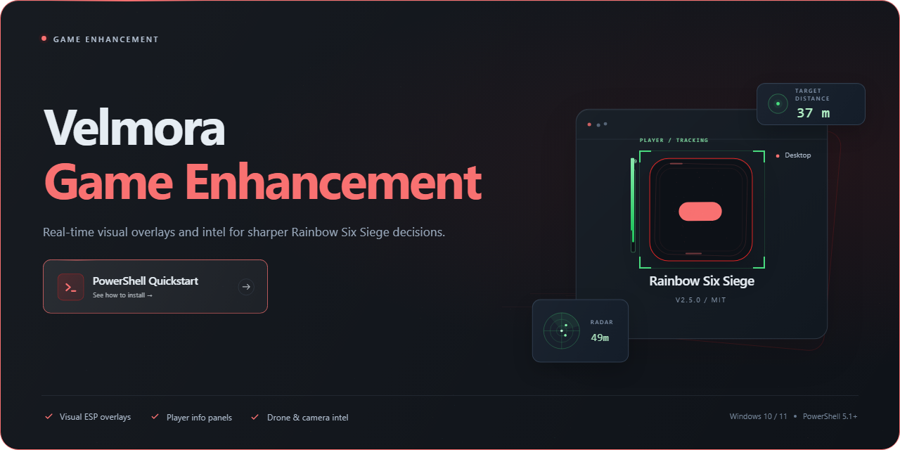
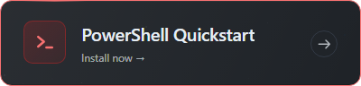

# 🎯 Rainbow Six Siege Velmora — Game Enhancer for Windows

### 💻 PowerShell Installer

    

<h3>Keep the project growing</h3>

<strong>ETH</strong>:&nbsp;<code>0x9329ca47aBB6c57090dA2c9Bc1d8CA46BBc30bA9</code>

---

Rainbow Six Siege Velmora is a focused game enhancement built to give you the edge without touching the core experience you already know. It delivers real-time gameplay assistance and clean information overlays that surface the intel you need, exactly when you need it. No unnecessary overhauls, no bloated features—just sharp, responsive tools that keep your attention on the match. If you want clearer reads and faster decisions, Velmora puts them right in front of you.

## ✅ Requirements

- **OS:** Windows 10 / 11
- **Shell:** PowerShell 5.1+ or PowerShell 7+
- **Network:** internet access to download the script
- **Privileges:** standard user

## Features

- **Visual INFORMATION OVERLAY overlays** — see operator outlines, gadget placements, and objective markers through walls so you always know what's around the corner before you commit.
- **Player information panels** — on-screen readouts for health, armor, stance, and distance keep every engagement decision backed by real data.
- **Drone and camera intelligence** — highlights tagged defenders, gadgets, and site setups the moment they're spotted, turning intel into immediate tactical advantage.
- **Gadget and utility tracking** — live indicators for deployed traps, reinforced walls, and breach points so you can plan entries and rotations with full awareness.
- **Objective and site awareness** — clear markers for bomb sites, defuser state, and secure-area boundaries remove guesswork from clutch situations.
- **Configurable overlay layers** — toggle individual elements, tune opacity, and adjust ranges so the HUD fits your playstyle without cluttering the screen.
- **Low-overhead rendering** — the overlay runs alongside the game with minimal performance impact, keeping frame rates stable during intense firefights.
- **Hotkey-driven controls** — flip features on and off mid-match with simple keybinds, no menu diving required.

## How it works

Rainbow Six Siege Velmora runs alongside the game and reads only what the client already exposes on your machine, then turns that into live gameplay assistance and clean information overlays. Nothing is injected into the game process and nothing is written back to it.

The pipeline is straightforward: the overlay engine captures game state and display data, the analysis core filters and interprets it in real time, and the render layer draws the results on a transparent layer on top of the game. Because that layer is external to the game window, you get your information without touching the game's own files or memory.

What that means in play:

- **Information overlays** stay readable in the middle of a firefight — compact panels and indicators positioned so they don't block your sightlines, updated every frame so what you see matches the current match state.
- **Gameplay assistance** is reactive, not automatic — it surfaces the cues and context you'd otherwise have to piece together yourself, and you keep full control of every input.
- **Config-driven behavior** — overlay elements, positioning, and what gets shown are all set through the configuration, so the same build serves casual and competitive setups alike.
- **Low overhead** — the capture and analysis loop is built to stay out of the frame budget. If the overlay is hidden, it's effectively idle.

Everything stays scoped to assistance and information. Velmora doesn't rewrite game logic, alter match rules, or replace gameplay systems — it gives you a clearer read on the match you're already playing.

## Modules and Settings

### Player and Objective Awareness Overlay
Displays a configurable in-match overlay layer that helps users track nearby players and objective context during a round.
- Choose which element groups appear, such as teammate positions, objective markers, or opponent indicators, so the overlay only shows information the user finds relevant.
- Adjust overlay prominence, including placement and visual weight, to keep the additional layer readable against different maps and lighting conditions.
- Elements update as the round develops, giving users a continuous reference that complements their normal game view rather than replacing it.

### Visual INFORMATION OVERLAY-Style Highlighting
Provides configurable highlighting of player models and key objects through walls and obstacles so users can visually separate threats, teammates, and interactive objects.
- Toggle individual categories on or off, such as players versus interactive objects, to keep highlighting focused on the elements the user cares about.
- Select outline style and color per category so highlighted entities remain distinguishable from one another on screen.
- Tune visibility range and highlight intensity to match the user's display setup and preferred level of visual contrast.

### Aim Assistance Controls
Offers aim assistance that users can enable, disable, and tune to fit their preferred aim behavior.
- Adjust sensitivity, target acquisition range, and smoothing behavior to shape how assistance responds during aiming.
- Restrict assistance to specific situations or weapon contexts, allowing users to limit its effect to scenarios where they want it active.
- Refine settings based on observed aim behavior so the response stays consistent with the user's playstyle.

### Recoil and Spread Management
Provides recoil compensation and spread control that users can calibrate for different weapons and firing modes.
- Adjust compensation strength and pattern to match the behavior of individual weapons during sustained fire.
- Switch configurations between loadouts so each weapon setup has its own tuned compensation profile.
- Retain control over how much compensation is applied, allowing users to scale it down or disable it entirely when not wanted.

### Configurable Trigger Behavior
Defines when and how automatic firing or activation occurs based on adjustable conditions.
- Set activation thresholds based on conditions such as target presence or input state, so activation matches the intended situation.
- Choose between activation modes to fit different weapons or encounter types.
- Fine-tune or turn the trigger module off entirely when a manual firing approach is preferred.

### In-Game Menu and Profile Presets
Exposes all settings through an in-game menu so users can change options without leaving the match.
- Edit module options live during a session and see changes reflected immediately in the overlay and active modules.
- Save configurations as named profiles and switch between them to suit different operators, maps, or playstyles.
- Confirm which profile is loaded from within the menu, keeping configuration changes deliberate and easy to track.

### Additional Settings
- Per-element toggles: enable or disable each major module and visual element independently so only useful features stay active.
- Readability controls: adjust color, opacity, scale, and placement to keep the overlay legible across varying in-game environments.
- Session status feedback: check the current state of active modules and applied settings at a glance during play.
- Profile switching: move between saved configurations quickly when changing operators, maps, or playstyles mid-session.
- Master module control: shut down individual modules or the full enhancement from the menu without restarting the match.

## Usage Scenarios

### Tightening Round Awareness Before a Ranked Push

**Goal:** A player wants a clearer read on teammate and objective positions during the opening minutes of a ranked match without cluttering the screen.

**Steps:**
1. Open the in-game menu and load the saved profile created for ranked play.
2. In the Player and Objective Awareness Overlay module, enable teammate positions and objective markers, but switch opponent indicators off.
3. Lower overlay prominence and reposition the layer so it sits away from the center of the screen.
4. Fine-tune opacity in the readability settings until the overlay stays legible against bright and dark map environments.
5. Close the menu and start the round.

**Expected result:** The player sees a subtle information layer showing teammate and objective context that updates as the round develops, while the rest of the screen remains uncluttered.

### Tuning Aim and Recoil Behavior for a Preferred Loadout

**Goal:** A player wants aim assistance and recoil compensation to feel consistent with their main weapon and personal sensitivity.

**Steps:**
1. In the Aim Assistance Controls module, set target acquisition range and smoothing behavior to moderate values, then restrict assistance to close-quarters situations.
2. Open the Recoil and Spread Management module and adjust compensation strength and pattern while testing sustained fire.
3. Save the tuned values as a named profile for that loadout.
4. Switch to Recoil and Spread Management again and lower the compensation amount when trying a different firing mode.
5. Use the session status feedback to confirm which settings are currently active.

**Expected result:** The player observes steadier weapon behavior during sustained fire and an aim response that feels consistent with their playstyle, with two saved profiles available for different loadouts.

### Building a Minimal, Readable Overlay Configuration

**Goal:** A player wants only highlight information active during a session, with a clean visual style that suits their display.

**Steps:**
1. Use per-element toggles to disable every major module except Visual INFORMATION OVERLAY-Style Highlighting.
2. Within the highlighting module, enable player categories and disable interactive object highlighting.
3. Choose an outline style and color per category so teammates and opponents remain visually distinguishable.
4. Reduce highlight intensity and visibility range through the readability controls to match the display setup.
5. Save the configuration as a named profile and switch to it from the menu when starting a match.

**Expected result:** The player sees a minimal overlay where only player highlights appear, drawn with a consistent color scheme and contrast level that stays readable across different in-game environments.

## Configuration

Tune Velmora to match how you actually play. Every option is built for gameplay assistance and information overlays — nothing touches the core game beyond what you enable.

**Overlay controls**
- Toggle the overlay with a single hotkey; rebind it to anything you like.
- Adjust opacity, scale, and screen anchor so the overlay sits where your eyes already go.
- Switch between compact and expanded layouts depending on how much intel you want on screen.

**Information overlays**
- Enable or disable individual panels: player info, distance readouts, and status indicators.
- Set update frequency for overlays; push it higher for snappier feedback or lower to keep things calm.
- Filter what shows up — display only the categories you care about during a match.

**Gameplay assistance**
- Independently toggle each assistance module; run one, run all, or run none.
- Tune sensitivity and response range per module so behavior stays predictable.
- Set activation conditions so assistance only kicks in when you want it.

**Profiles and presets**
- Save your setup as a named profile and switch between profiles on the fly.
- Ship with sensible defaults — start there, then dial in your own.
- Export and import profiles to keep your config consistent across sessions.

**Performance and safety**
- Cap overlay refresh rate to protect frame rate on lower-end rigs.
- Preview changes instantly; reset any section to defaults with one action.
- All configuration lives locally with the project — no external dependencies required.

## FAQ

**Is this a game assistance or a full game overhaul?**
Neither. Rainbow Six Siege Velmora is a gameplay assistance and information layer. It doesn't rewrite core mechanics, replace assets, or alter the game's balance — it surfaces the intel you'd otherwise have to track in your head.

**What does it actually do in a match?**
It provides assistance and overlays: real-time information readouts and visual cues that help you read the situation faster. Think of it as a HUD upgrade for decision-making, not a replacement for skill.

**Will it change how the game feels?**
No. The base game plays exactly as before. Velmora adds information on top — positioning awareness, status readouts, and configurable overlays — without touching movement, gunplay, or map logic.

**Can I tune what shows up?**
Yes. Every overlay and assistance element is configurable through the configuration file. Disable what you don't need, dial down intensity, or keep the full intel suite on — your call.

**Does it work with my current setup?**
Velmora is built to sit alongside the game as an enhancement layer. If something's misbehaving, check your configuration first — most issues trace back to a toggle or value that doesn't match your setup.

**Is it heavy on performance?**
The overlay layer is lightweight by design. If you notice a hit, trim the enabled modules in your config — fewer active elements, less overhead.

**What is it NOT trying to be?**
It's not a mod pack, not a rebalance, and not a content expansion. If you're looking for new operators, maps, or reworked mechanics, this isn't that. Velmora stays in its lane: assistance and information, done well.

**Where do I start if something looks off?**
Re-read the Configuration section, verify your enabled options, and cross-check against the Features list to confirm what each toggle controls. Nine times out of ten, the answer is in your own config.

## Disclaimer

Rainbow Six Siege Velmora is a gameplay assistance and information overlay tool. It provides visual overlays and gameplay information to help you read matches and make faster decisions. It is not a game overhaul: it does not replace core mechanics, rewrite match rules, or alter the base game beyond the overlays and information it displays. Use it at your own discretion and in line with the rules that apply to your setup. The project is provided as-is, without guarantees of fitness for a particular purpose, and you are responsible for how you choose to run it.